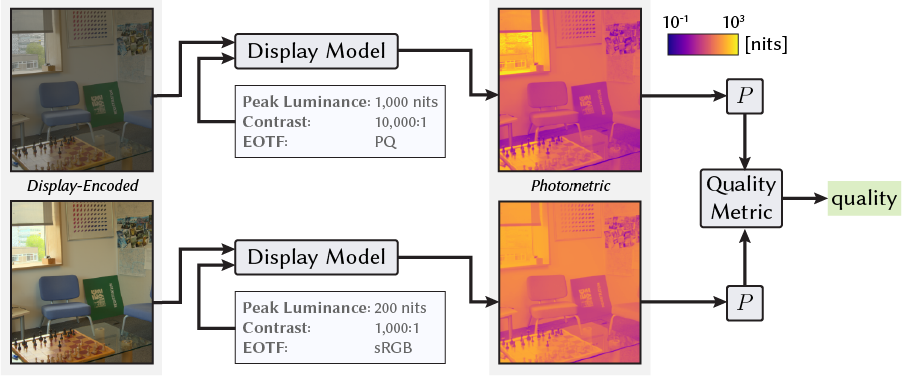

<div align="center">

<h1>Adapting Quality Metrics to Tone Mapping</h1>

[**Kenneth Chen**](https://kenchen10.github.io/)<sup>1</sup>,
[**Dongyeon Kim**](https://dongyeon93.github.io)<sup>2</sup>,
[**Yuta Asano**](https://scholar.google.com/citations?user=N0WYkZkAAAAJ&hl=en&oi=ao)<sup>3</sup>,
[**Alexandre Chapiro**](https://achapiro.github.io/)<sup>3</sup>,
[**Qi Sun**](https://qisun.me/)<sup>1</sup>,
[**Rafał K. Mantiuk**](https://www.cl.cam.ac.uk/~rkm38/index.html)<sup>2</sup>

<sup>1</sup>
<a href="https://www.immersivecomputinglab.org/research/"></a>
&emsp;
<sup>2</sup>
<a href=""></a>
&emsp;
<sup>3</sup>
<a href=""></a>

<!-- <a href="https://arxiv.org/abs/2407.01866"></a> -->
<a href="https://kenchen10.github.io/projects/tmometric/index.html"></a>

</div>


<div style="width: 90%; margin: 0 auto;">

  <sub>
  In tone mapping, the absolute luminance of HDR reference and tone-mapped test can differ significantly. To accurately predict quality, our display model maps display-encoded content to photometric values, given the specifications of the display. The colormap represents the photometric values in nits. Next, a perceptual transfer function, P() maps these values to a shared display-encoded representation (e.g. 0-1), usable by the quality metric.
  </sub>
</div>

## Abstract 
Tone mapping evaluation is difficult because of the substantial differences in absolute luminance between high dynamic range (HDR) reference and tone-mapped standard dynamic range (SDR) test content. To address this challenge, we collected a new tone mapping evaluation dataset, focused on fundamental tone mapping operations, and combined it with several existing tone mapping quality assessment datasets. Rather than introducing new specialized metrics designed for tone-mapped content, we instead developed a set of techniques to adapt existing metrics for tone-mapped content. Our approach models the photometric differences between HDR reference and SDR test displays for accurate metric predictions. The technique consists of two steps: first, a display model converts display-encoded content to photometric values; second, these values are re-encoded using a perceptual transfer function for both HDR and tone-mapped images. We systematically evaluated both general-purpose image and video quality metrics with our adaptations and those specifically designed for tone mapping. With these adjustments, general-purpose metrics perform much better for tone mapping evaluation, consistently outperforming previously established specialized techniques. Additionally, we modified the ColorVideoVDP metric to be sensitive to absolute luminance changes, resulting in ColorVideoVDP-tm, which shows greatly improved performance and accepts photometric values as input. These results highlight the robustness of our adaptation technique and provide an improved protocol for evaluating future tone mapping quality metrics. Refer to our supplementary webpage for all data and stimuli.

## Data & Code

**Dependencies**

The code in this repository relies on [ColorVideoVDP](https://github.com/gfxdisp/ColorVideoVDP) (version>=0.6.0). Please follow their installation instructions.

Example metrics are provided by `piq`. Install as follows:
```
pip install piq
```

**Data**

User study stimuli, raw data and results scaled to Just-Objectionable-Difference (JOD) units for our work can be found [here](https://www.repository.cam.ac.uk/items/2f7c9a2a-ffe5-4d61-92b2-f6cb4928f119).

**Code**

Quick start with using our adaptation strategy can be found in `run_metric.py`. This example predicts quality for an image in the [TMIQD dataset](https://drive.google.com/file/d/0B7jKyX6oxhG3OUs4OHA5MFRMVWs/view?resourcekey=0-ZHMdz5_I-iSWVWDFZNOpDg).


## Acknowledgements
Thank you to the user study participants for their time and to the anonymous reviewers for their insightful feedback.

## Contact
Contact [Kenneth Chen](https://kenchen10.github.io) ([kennychen@nyu.edu](mailto:kennychen@nyu.edu)) with any questions about the codebase or data.


## Citation
If you find this project helpful to your research, please consider citing us:
```bibtex
@inproceedings{
    chen2026adapting,
    author = {Chen, Kenneth and Kim, Dongyeon and Asano, Yuta and Chapiro, Alexandre and Sun, Qi and Mantiuk, Rafa\l{} K},
    title = {Adapting Quality Metrics to Tone Mapping},
    year = {2026},
    publisher = {Association for Computing Machinery},
    address = {New York, NY, USA},
    url = {https://doi.org/10.1145/3799902.3811107},
    doi = {10.1145/3799902.3811107},
    booktitle = {Proceedings of the Special Interest Group on Computer Graphics and Interactive Techniques Conference Conference Papers},
    series = {SIGGRAPH Conference Papers '26}
 } 

```